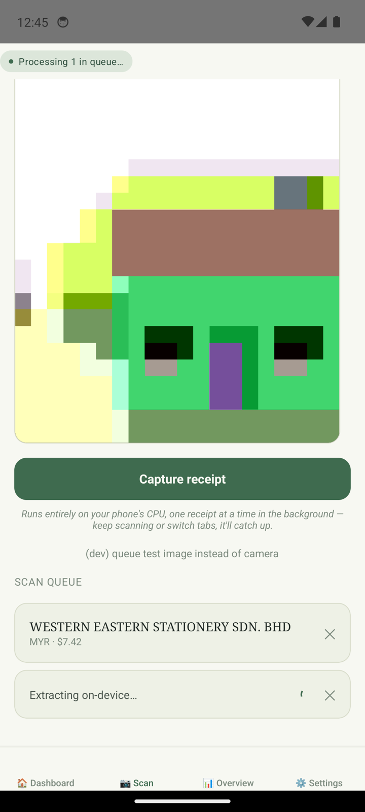

# LedgerLens

**Offline, on-device invoice & receipt extraction.** Photo of a receipt in → structured JSON out (vendor, date, currency, total, tax, line items) — running privately on a phone, no network, no cloud. Because it must run on a mid-range Android device, model compression (distillation → quantization → pruning) is a *requirement of the use case*, and the headline deliverable is the accuracy-vs-size/latency **Pareto grid**.

> **Status: Weekend 2 — LoRA-distilled Qwen2-VL-2B is trained, evaluated (fp16 and deployment-format GGUF), and beats both the stock 2B baseline and the Qwen2.5-VL-7B teacher.** Weekend 3 (PTQ/pruning compression grid) is in progress. Every number below comes straight from `results/results.csv` / `results/efficiency.csv`, produced by `uv run ledgerlens eval` / `scripts/bench_efficiency.py` — nothing here is hand-computed.

## Try it in two minutes

Photo of a receipt in, JSON out, on your laptop, fully offline after a one-time 2.3 GB download.

```sh
brew install llama.cpp          # or grab a release build with mtmd from github.com/ggml-org/llama.cpp
git clone https://github.com/iivek/LedgerLens && cd LedgerLens
scripts/demo.sh path/to/receipt.jpg
```

The script downloads the distilled model (`Q4_K_M` GGUF + `f16` vision tower) from
[Hugging Face: ii42/LedgerLens-Qwen2-VL-2B-Receipts-GGUF](https://huggingface.co/ii42/LedgerLens-Qwen2-VL-2B-Receipts-GGUF)
into `models/gguf/` and runs `llama-mtmd-cli` with the exact prompt the model was trained on.
Expect roughly 3-15 s per receipt on Apple Silicon, longer on CPU-only machines.
Weights are research/noncommercial-only, see [License](#license).

## Baseline: stock Qwen2-VL-2B, zero fine-tuning

Measured on this repo's own eval harness, running the deployment runtime (llama.cpp, this exact GGUF) locally on a MacBook M1 Pro — not a rented GPU, not the phone yet. `fields_em_mean` averages only the fields each dataset actually annotates (SROIE: vendor/date/total; CORD: total/tax/line-items — see [CLAUDE.md](CLAUDE.md) on why).

*(Rescored — see `scripts/rescore.py` — after two metric bugs were found and fixed: a line-item null-handling bug that understated line-item F1 by ~9-10pp, and a date-normalization gap that let the model's non-ISO output coincidentally match SROIE gold's own non-canonical fallback text, inflating date accuracy. Original numbers are still in `results/results.csv` under the non-`-rescored` tags for the audit trail.)*

| Variant | Split (n) | JSON valid | Field EM (mean) | Vendor / Date / Total EM (SROIE) | Line-item F1 | Latency p50 / mean |
|---|---|---|---|---|---|---|
| Q4_K_M (940 MB) | SROIE (347) | 96.0% | 77.3% | 81.8% / 59.9% / 90.2% | — | 13.6s / 17.0s |
| Q4_K_M (940 MB) | CORD (100) | 98.0% | 60.0% | — | 86.0% | 8.9s / 13.7s |
| Q8_0 (1.5 GB) | SROIE (347) | 95.7% | 77.9% | 82.4% / 63.1% / 88.2% | — | 13.7s / 18.5s |
| Q8_0 (1.5 GB) | CORD (100) | 98.0% | 63.5% | — | 83.7% | 10.3s / 15.9s |

**Honest read, not a one-sided one:** Q8_0 is not more accurate than Q4_K_M in any way that survives scrutiny — and it isn't uniformly *worse* either. Per-field, the two trade places: Q8 leads on CORD total EM (+7pp) and SROIE vendor EM (+0.6pp); Q4 leads on SROIE date EM (+3.2pp) and SROIE total EM (+2pp). A real quantization effect shouldn't flip direction between datasets — this pattern is consistent with sampling noise at this sample size (SROIE n=347, CORD n=100; a single unpaired run each), not a "diminishing returns" finding. Treat it as unresolved, not as evidence, until it's checked with paired significance tests and repeated runs.

Date EM is the field most worth reading carefully: after the metric fix, it's the clear accuracy floor (~60-63%) despite total EM staying high (~88-90%) — largely because the model rarely follows the prompt's requested `YYYY-MM-DD` format even when it reads the date correctly, and the corrected metric no longer gives credit for that.

CORD scores lower on tax/total than SROIE's headline fields because it's a harder distribution (richer line-item structure, no vendor/date/currency annotated at all). Per the spec's contingency: if distillation doesn't clearly beat this stock baseline, the story pivots to "how small can we go," not "look how much we improved."

### SROIE train/test overlap — vendor-disjoint numbers

The Kaggle SROIE mirror (`urbikn/sroie-datasetv2`) is a re-split of the same underlying 973 receipts, not the official ICDAR test set. Checked directly against the current data: **7/347 test images are byte-identical to a training image** (left as-is — 2% of the split, not worth the churn to hunt down and relabel by hand), and **72.6% of test receipts share a vendor string with a training receipt** (252/347). Vendor overlap is the one worth correcting for, since it can inflate vendor accuracy independent of whether the model can actually read a receipt it hasn't seen the store's layout for before.

`scripts/rescore.py --vendor-disjoint-against <train-split>` restricts scoring to the 95 test receipts whose vendor does *not* appear in `sroie_train` — no re-running the model, just re-scoring the existing predictions:

| Variant | Vendor EM (full test, n=347) | Vendor EM (vendor-disjoint, n=95) | Date EM (disjoint) | Total EM (disjoint) |
|---|---|---|---|---|
| Q4_K_M | 81.8% | **61.1%** | 56.8% | 90.5% |
| Q8_0 | 82.4% | **62.1%** | 57.9% | 88.4% |

A 20-point gap. Important nuance: **this is the stock, zero-fine-tuned model** — it has never trained on any SROIE data, so this isn't training-set memorization in the usual sense. The more likely explanation is that vendors repeating across train/test tend to be larger, more common chains, and the model's own general-purpose pretraining gives it an edge recognizing familiar branding — an edge that doesn't extend to rarer, less-common vendors. Either way, the full-test vendor number is not a reliable estimate of performance on a vendor the model hasn't effectively seen before, whatever the cause. **This check becomes essential once real fine-tuning happens on `sroie_train`** — at that point the same gap could additionally reflect genuine training-set memorization, and vendor-disjoint scoring is how that gets caught rather than published as a clean win.

**The vision tower (mmproj, 1.33 GB) has not been quantized in either variant above and is larger than the 4-bit LLM (0.99 GB)** — the 940MB/1.5GB figures describe the LLM only; deployed footprint including mmproj is 2.32 GB (Q4) vs 2.98 GB (Q8), a much smaller ratio than the LLM-only numbers suggest. This is also the leading candidate explanation for why LLM-only quantization shows so little effect above.

## Weekend 2: distillation result

LoRA-SFT of the student (Qwen2-VL-2B) on `teacher-agree`-blended targets (see [CLAUDE.md](CLAUDE.md) — a field the source dataset annotates is checked against gold per-field before trusting the teacher; an unannotated field always takes the teacher's read, since gold is always null there). Trained on Kaggle T4 ×2 (not a rented 24 GB box — see below), checkpoint selected by `eval_loss` on a held-out `cord_val` split, merged, then evaluated two ways: served fp16 via `transformers` (Kaggle T4) and exported to the actual deployment format (GGUF Q4_K_M + f16 mmproj, served via `llama-server` on the M1 Pro — the same runtime the phone uses).

| Variant | Split (n) | JSON valid | Total EM | Field EM (mean) | Line-item F1 | Mean latency |
|---|---|---|---|---|---|---|
| Teacher 7B (4-bit, zero-shot) | CORD (100) | 97.0% | 85.0% | 86.0% | 87.7% | 29.3s |
| Teacher 7B (4-bit, zero-shot) | SROIE (347) | 96.5% | 94.2% | 90.1% | — | 38.5s |
| **Distilled 2B, fp16** | CORD (100) | **100%** | **92.0%** | **93.5%** | **94.7%** | **10.0s** |
| **Distilled 2B, fp16** | SROIE (347) | **100%** | **96.8%** | **94.3%** | — | **11.0s** |
| **Distilled 2B, GGUF Q4_K_M** | CORD (100) | **100%** | **91.0%** | **92.0%** | **93.8%** | **11.8s** |
| **Distilled 2B, GGUF Q4_K_M** | SROIE (347) | **100%** | **96.5%** | **95.2%** | — | **14.7s** |

**Read this correctly, not as "a 2B model out-reasoning a 7B":** the teacher above is zero-shot and 4-bit; the student is fine-tuned directly on in-distribution CORD/SROIE data with the field-level blend giving it *gold-quality supervision* on every field those datasets annotate — something the teacher never had. This is task specialization beating general-purpose zero-shot inference, which is the expected, intended outcome of distillation, not a surprising capability result. All rows above are single unpaired runs; a proper paired-significance comparison (student vs. teacher, GGUF vs. fp16) has not been run yet — treat the ranking as directionally real (backed by very large, consistent gaps: 7-12pp) but not yet statistically confirmed at the field level.

**Quantization vs. runtime confound:** the fp16 rows ran on HF/Kaggle at a fixed `max_pixels` budget; the GGUF rows ran on llama.cpp/M1 with images sent at native resolution (see [CLAUDE.md](CLAUDE.md) on `-c` sizing). The ~0.3-1.1pp gap between them is therefore quantization *and* runtime *and* image-resolution-handling conflated, not a clean int4-vs-fp16 delta — the gap being small either way is good news, but isolating the quantization-only effect needs an f16/Q8_0/Q4_K_M sweep run entirely within the GGUF/llama.cpp runtime (not yet done).

**SROIE vendor-disjoint check, now with real fine-tuning in the picture:** SROIE train/test share 72.6% of vendor strings and 7 byte-identical images (see [CLAUDE.md](CLAUDE.md)) — this is exactly the setup where genuine training-set memorization, not just familiarity from pretraining, becomes possible. Rescored on the 95 test receipts whose vendor never appears in `sroie_train`:

| Variant | Total EM (full, n=347) | Total EM (vendor-disjoint, n=95) | Vendor EM (disjoint) | Date EM (disjoint) |
|---|---|---|---|---|
| Distilled 2B, fp16 | 96.8% | 92.6% | 76.8% | 93.7% |
| Distilled 2B, GGUF Q4_K_M | 96.5% | 91.6% | 75.8% | 94.7% |

A real but modest drop (~4-5pp on total EM), and still well above the *stock* model's vendor-disjoint numbers (61-62% vendor EM, 88-91% total EM — see the stock table above). The model isn't just memorizing vendor layouts from training; it retains most of its accuracy on vendors it never saw during fine-tuning.

None of PTQ (AWQ/GPTQ), QAT, or pruning-with-recovery is complete yet — pruning is in progress; AWQ/GPTQ/QAT have not been attempted. Those are the remaining Weekend 3 compression-grid points.

**On latency vs. the spec's "~1-2 seconds on a phone" target:** these numbers (13-18s mean, up to 40-49s p95) are already far above that, and they're on a **GPU-accelerated M1 Pro** — the current Android JNI code runs **CPU-only**. A mid-range Android phone's CPU is meaningfully slower than an M1 Pro's GPU, so on-device latency today is very likely in the tens of seconds to low minutes, not 1-2 seconds. The compression plan as designed (int4 LLM + pruning) targets a ~1.5-2x speedup, which does not close a gap of this size — most of the latency is plausibly vision-token prefill (the mmproj is unquantized and image-token budget isn't yet a compression axis). The 1-2s target needs to be either restated honestly or the plan needs to add image-resolution/token-budget reduction and GPU delegation as explicit levers, before this claim goes in front of anyone evaluating compression work.

## Architecture

```
CORD + SROIE + synthetic invoices
        │
        ▼
Qwen2.5-VL-7B teacher ──labels──▶ SFT (LoRA) ──▶ Qwen2-VL-2B student
                                                    │
                              ┌─────────────────────┼──────────────────┐
                              ▼                     ▼                  ▼
                         PTQ (AWQ/GPTQ)        QAT (torchao)      pruning (+recovery)
                              └─────────────────────┼──────────────────┘
                                                    ▼
                                        GGUF (q4_k_m) + mmproj
                                                    ▼
                                 llama.cpp / mtmd — laptop CPU & Android app
```

Every variant is one row in `results/results.csv` (accuracy, from the harness) joined with `results/efficiency.csv` (size / peak RAM / tok/s / latency) on `tag` — one point on the Pareto grid.

## Setup

```sh
uv sync                     # core + dev (harness, metrics, synthetic gen)
uv sync --extra data        # + HF datasets (CORD download)
uv sync --extra render && uv run playwright install chromium   # optional; system Chrome also works
# GPU box only:
uv sync --extra gpu
```

## The one-command eval

```sh
uv run ledgerlens eval --runner hf --model Qwen/Qwen2-VL-2B-Instruct \
    --split data/processed/cord_test.jsonl --tag student2b-stock --host gpu
```

Appends one aggregate row to `results/results.csv` and persists per-sample raw outputs to `runs/<tag>/predictions.jsonl` for audit. The `llamacpp` runner evaluates the *deployed* GGUF through a local `llama-server`, i.e. the same runtime the phone uses:

```sh
llama-server -m models/gguf/sft2b-teacher-agree-q4_k_m.gguf --mmproj models/gguf/mmproj-sft2b-teacher-agree-f16.gguf -c 4096 --port 8080
uv run ledgerlens eval --runner llamacpp --split data/processed/cord_test.jsonl \
    --model-path models/gguf/sft2b-teacher-agree-q4_k_m.gguf --mmproj-path models/gguf/mmproj-sft2b-teacher-agree-f16.gguf \
    --tag student2b-q4km --host laptop-cpu
```

Every row also carries `prov_*` provenance columns (model file SHA256 + size, runtime version, sampler settings) captured automatically from the runner — not just the human-typed `tag`, so "every number reproducible" doesn't rest on naming discipline alone.

**Metrics** (fixed before any training): per-field exact-match & F1 (vendor, date, currency, total, tax; totals compared with separator normalization and ±0.005 tolerance), JSON-validity rate, line-item F1 with Hungarian matching over (description, qty, price), and latency percentiles.

## Data

```sh
uv run ledgerlens convert cord              # CORD-v2 via HuggingFace → data/processed/
uv run ledgerlens convert sroie             # needs SROIE2019/ under data/raw/ (see src/ledgerlens/data/sroie.py)
uv run ledgerlens synth --n 2000            # synthetic invoices → data/synthetic/
```

The synthetic generator renders Jinja2 HTML templates (thermal receipt + A4 invoice), with randomized vendors, currencies (incl. `1.234,56`-style separators and zero-decimal IDR/VND), then applies phone-photo augmentations (perspective, shadows, low light, motion blur, JPEG). Gold labels are exact by construction.

CORD and SROIE are **research-use** datasets; model weights trained on them are labeled accordingly. See [DATA_LICENSES.md](DATA_LICENSES.md) for exact terms — CORD is confirmed CC-BY-4.0, SROIE's dataset-level license could not be independently verified and is treated as research-use only pending confirmation from the ICDAR/RRC organizers.

**Personal holdout** (spec §4 — the honest "does it actually work" set, ~50 real receipts, never trained on): drop photos in `data/personal_holdout/raw/`, run `uv run ledgerlens convert personal` once to scaffold a blank label JSON per photo in `data/personal_holdout/labels/` (matching the `Extraction` schema), hand-fill each with what the receipt actually says, then rerun the same command to build `data/personal_holdout.jsonl`. A typo'd field name fails loudly (not silently null) since these are hand-typed. Never committed (`data/personal_holdout/` is gitignored); redact or exclude before publishing anything derived from it.

## Training & compression (Kaggle T4 ×2, free tier — not a rented 24 GB box)

Every GPU-side script runs on Kaggle's free T4 tier via chunked kernel pushes (one session can't fit a multi-hour job); see [CLAUDE.md](CLAUDE.md) for the account-pooling/driver details. Status: `teacher_label.py` → `train_sft.py` → `export_gguf.py` done and evaluated (see the distillation table above); `prune.py` in progress; `quantize_ptq.py` (AWQ/GPTQ) and `qat_torchao.py` not yet attempted (the latter has a documented decision not to spend one-shot GPU budget on it until its output is loadable — see the script's docstring).

```sh
python scripts/teacher_label.py --split data/processed/cord_train.jsonl --out data/distill/cord_train_teacher.jsonl
python scripts/train_sft.py --data data/distill/*.jsonl --policy teacher-agree --out runs/sft-2b --merge
python scripts/quantize_ptq.py awq  --model runs/sft-2b-merged --out models/student2b-awq-int4
python scripts/qat_torchao.py       --model runs/sft-2b-merged --data data/distill/cord_train_teacher.jsonl --out models/student2b-qat
python scripts/prune.py             --model runs/sft-2b-merged --drop 6 --calib data/distill/cord_train_teacher.jsonl --image-root <train-data-mount> --out models/student2b-prune6
python scripts/export_gguf.py       --model runs/sft-2b-merged --name ledgerlens
python scripts/bench_efficiency.py gguf --model models/gguf/sft2b-teacher-agree-q4_k_m.gguf --mmproj models/gguf/mmproj-sft2b-teacher-agree-f16.gguf --image <receipt.jpg> --tag student2b-q4km --host laptop-cpu
```

## Mobile app

`mobile/` is a **React Native app and the active app** — camera → on-device `llama.rn`
inference → structured JSON, editable review card, local SQLite ledger, **no INTERNET
permission** in the release manifest. Verified end-to-end on real hardware (Nothing
Phone 3), with a real, chip-gated GPU-vs-CPU-fallback latency gap. See
[mobile/README.md](mobile/README.md) for setup, and [CLAUDE.md](CLAUDE.md)'s mobile
caveat section for the actual measured numbers plus the full on-device debugging
history (a thermal-throttling incident, a GPU-acceleration regression and its later
reversal, and the evidence trail behind both) — deliberately not repeated here, since
those are manual on-device observations, not `bench_efficiency.py`/`results.csv`
harness output, and this project's own hard rule is that published numbers come from
the harness, not hand-transcription (see below).

<p align="center">
  
</p>

*Scan tab of a **debug build on the Android emulator**, not a phone: the viewfinder shows the emulator's synthetic camera scene, and the "(dev) queue test image" button is debug-only. The scan queue shows one finished on-device extraction of a real SROIE test receipt (vendor, currency, total read correctly) and a second receipt still extracting while the camera stays live for the next shot.*

`android/` is an earlier Kotlin/Compose prototype (same idea: camera → local llama.cpp
`mtmd` inference → JSON), **kept for reference only, superseded by `mobile/`**. See
[android/README.md](android/README.md) if you want to build it anyway.

## Tests

```sh
uv run pytest
```

## Sharing the model

Model weights are never committed to this repo (`models/`, `runs/` are gitignored —
see [CLAUDE.md](CLAUDE.md)'s environment notes). To share a checkpoint:

1. **Host on [Hugging Face Hub](https://huggingface.co)** — the standard place for both
   the fp16/safetensors checkpoint and the deployment GGUF (+ mmproj). Create the repo,
   then `huggingface-cli upload <repo> models/gguf/`.
2. **Set the model card's license to `other`**, with `license_name: polyform-noncommercial-1.0.0`
   and `license_link` pointing straight back to this GitHub repo's
   [`MODEL_LICENSE.md`](MODEL_LICENSE.md) — HF's model-card metadata accepts an external URL
   for `license_link`, no need to duplicate the license text into the HF repo itself.
3. **Attribute the training data in the model card**, per
   [`DATA_LICENSES.md`](DATA_LICENSES.md): CORD (CC BY 4.0, NAVER CLOVA) and SROIE
   (ICDAR 2019 RRC Task 3, license unconfirmed — flag the model as research-use only on
   this basis independent of whichever license text is chosen, since that constraint
   comes from the upstream data, not from this project's own licensing decision).
4. **Link back here** for reproduction (this README's training/compression commands,
   `results/results.csv` for the numbers, `CLAUDE.md` for architecture/gotchas).

The distillation code itself needs no separate sharing step beyond making this repo
public — everything under `src/`, `scripts/`, `mobile/`, `android/` is already here,
already reproducible via the commands above, and already covered by `LICENSE`.

## License

**Code:** [PolyForm Noncommercial 1.0.0](https://polyformproject.org/licenses/noncommercial/1.0.0) — see [`LICENSE`](LICENSE). Free for personal, research, educational, and
other noncommercial use; commercial use requires a separate agreement with the
copyright holder.

**Model weights:** [`MODEL_LICENSE.md`](MODEL_LICENSE.md) — noncommercial for two
independent reasons: by choice (same PolyForm terms), and by necessity regardless of
that choice, since SROIE's dataset-level license is unconfirmed and every checkpoint in
this project trains on it (see [`DATA_LICENSES.md`](DATA_LICENSES.md)).

**Datasets:** their own terms, not this project's to grant or restrict — see
[`DATA_LICENSES.md`](DATA_LICENSES.md).
